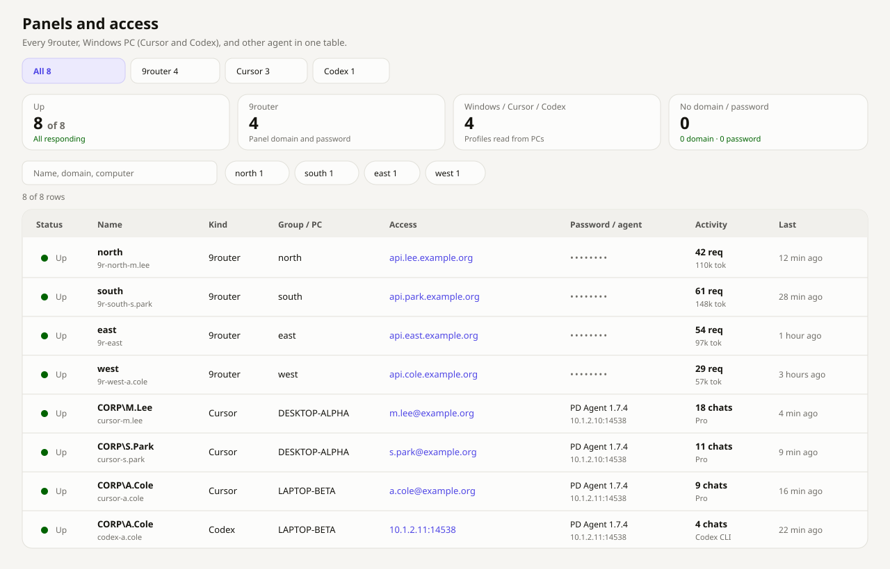
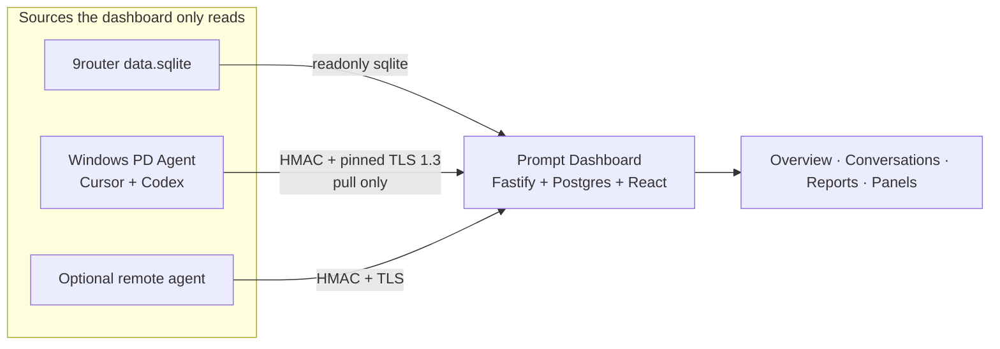

# Prompt Dashboard

**داشبورد پرامپت** — a web app for seeing what people actually sent to Claude (and to Cursor / Codex on Windows): the prompt, the tools, the answer, and the tokens.

FA / EN UI, Jalali + Gregorian dates (Tehran time), one admin login.

| Overview | A conversation | Panels and access |
| --- | --- | --- |
| [](docs/screenshots/overview.svg) | [](docs/screenshots/conversation.svg) | [](docs/screenshots/panels.svg) |

The pictures above use **sample data** (the same shape as `npm -w server run dev:fixture`). They are not a live environment.

## What it is for

- **Who** used which 9router, in which chat, with which model.
- **What** they typed, which tools ran, and what the model returned — without storing the same history twice.
- **How much** it cost in tokens (input, output, cache), per day / person / key / model.
- **Where to sign in**: panel domain, quota page, and the panel password for each 9router, in one filterable table.
- **Local Cursor and Codex** chats on Windows PCs, through a pull-only agent (the PC never connects out).

More detail lives in [docs](docs/).

## Example data (fixture week)

These rows match the Overview picture. They are invented users on invented sources.

**People**

| User (Windows profile) | Source | Messages | Input tokens | Output tokens |
| --- | --- | --- | ---: | ---: |
| M.Karimi | flytoday | 312 | 1.10M | 240k |
| S.Rezaei | flytoday | 288 | 980k | 210k |
| P.Sahebi | hotel | 241 | 860k | 188k |
| A.Moradi | parto | 256 | 740k | 152k |
| N.Hosseini | devops | 187 | 520k | 100k |

**One turn** (what ingest stores after it reads a 9router row)

```json
{
  "id": "r42",
  "timestamp": "2026-11-15T07:04:00.000Z",
  "provider": "anthropic",
  "model": "claude-opus-5-5",
  "data": {
    "client": "cursor",
    "tokens": { "input_tokens": 6100, "output_tokens": 780, "cache_read_input_tokens": 36000 },
    "request": {
      "system": "Claude Code. cwd: C:\\Users\\M.Karimi\\repos\\app",
      "messages": [
        { "role": "user", "content": [{ "type": "text", "text": "Fix the failing unit test in BookingService.spec.ts" }] },
        { "role": "assistant", "content": [
          { "type": "text", "text": "I'll start by reading the test." },
          { "type": "tool_use", "name": "Bash", "input": { "command": "git diff main...HEAD --stat" } }
        ]}
      ]
    }
  }
}
```

The dashboard turns that into blocks (human / assistant / tool), hashes each message so the same prefix is not stored again, and attributes the person from a `C:\\Users\\<name>` path in the system text.

**Panels table** (same four gateways as the picture)

| Status | Panel | Group | Panel / API | Quota | Today |
| --- | --- | --- | --- | --- | ---: |
| Up | m.karimi | flytoday | api.karimi.example.org | karimi.example.org | 42 req · 110k tok |
| Up | s.rezaei | flytoday | api.rezaei.example.org | rezaei.example.org | 61 req · 148k tok |
| Up | hotelcontract | hotel | claude.hotel.example.org | hotel.example.org | 54 req · 97k tok |
| Up | n.hosseini | devops | api.hosseini.example.org | hosseini.example.org | 29 req · 57k tok |

Click **Up / No domain / No password**, a group chip, or the search box to filter that table. Passwords are AES-256-GCM in Postgres and only appear after Show or Copy.

## How it fits together



- Each folder under `/sources` (up to 5 levels) that contains `data.sqlite` is a source. Per-user 9routers of the form `…/<org>users/<user>` show up as `<org>/<user>` (example: `flytoday/m.karimi`).
- The app opens those databases **read-only**. It does not use the Docker socket, does not exec into 9router, and does not restart anything.
- If a 9router folder disappears, the panel is marked “removed from the server”; history stays until you purge it in Settings.
- Windows: `pd-agent` listens on the PC. The dashboard pulls `cursor-*` and `codex-*` sources. Codex is `%USERPROFILE%\.codex` rollout JSONL; `auth.json` is never opened.

## Install on a server

```bash
mkdir -p /opt/prompt-dashboard && cd /opt/prompt-dashboard
# copy this repo here
cp .env.example .env
```

Fill `.env` (never commit it):

| Variable | Purpose |
| --- | --- |
| `PORT` | Host port (default `9010`) |
| `ADMIN_PASSWORD` | First admin password; change it later in Settings |
| `SESSION_SECRET` | Long random string: `openssl rand -hex 32` |
| `POSTGRES_PASSWORD` | Internal Postgres |
| `COOKIE_SECURE` | `true` only behind HTTPS |
| `TRUST_PROXY` | `true` only behind nginx / Traefik that sets `X-Forwarded-For` |
| `RESET_ADMIN_PASSWORD` | Set `true` once to reset the admin password to `ADMIN_PASSWORD` |

Point `docker-compose.yml` volumes at your 9router data directories, then:

```bash
docker compose up -d --build
docker compose ps
curl -s localhost:9010/healthz
```

Open `http://<server>:9010` and sign in. The default schedule syncs every 5 minutes.

> Run compose commands only in this project directory.

### Add a 9router

**New user from your own `add-user.sh`:** if the whole users tree is mounted, the dashboard finds it within a minute (or click “Find new 9routers” in Settings → Sources).

```bash
./add-user.sh acme j.doe 9201
```

**Standalone folder:** add a volume and recreate the app:

```yaml
      - /opt/9router-newteam/data/db:/sources/newteam:ro
```

**9router on another machine:** [docs/servers.md](docs/servers.md).

**Cursor / Codex on Windows:** [docs/windows-agent.html](docs/windows-agent.html) — pairing, the one-line install command, and what the agent will not do.

Panel passwords are not read from 9router `.env` files. Paste the password in **Panels → Edit**, or load it on the server without printing it:

```bash
grep '^INITIAL_PASSWORD=' /path/to/user/.env | cut -d= -f2- \
  | docker exec -i prompt-dashboard-app node server/dist/tools/panel-password.js acme/j.doe ".env (INITIAL_PASSWORD)"
```

## Local development

```bash
npm install
npm test                          # server tests (vitest + PGlite)
npm -w web run build
npm -w server run dev:fixture     # in-memory Postgres + sample sqlite, admin password: dev-password-1
```

Hot reload — two terminals:

```bash
npm -w web run dev
npm -w server run dev:fixture
```

That fixture is what the README pictures are drawn from (flytoday, hotel, parto, devops).

## Layout

```
server/src
  ingest/      sqlite or remote agent, upsert, skip duplicate history
  agent.ts     read-only agent for other Linux hosts
  normalize/   9router / Cursor / Codex rows → message blocks
  api/         REST
  scheduler.ts sync + retention
  auth.ts      argon2 admin cookie + rate limit
  db/          schema.sql, Postgres
web/src
  pages/       overview, explore, conversation, reports, panels, schedules, settings
  components/  shared UI
  lib/         API, dates, numbers, i18n
agent-windows/ Windows PD Agent (Go): Cursor state.vscdb + Codex JSONL
```

## Publishing this repo

Do not commit `.env`, `pgdata`, `agent-bin/`, `agent-windows/*.exe`, or `.deploy/`. Those are already gitignored. Strip any live passwords from docs and scripts before a public push; the examples here use `example.org` and fixture names only.
